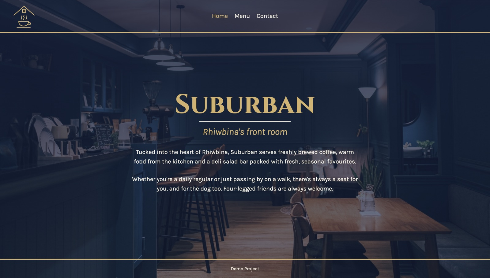
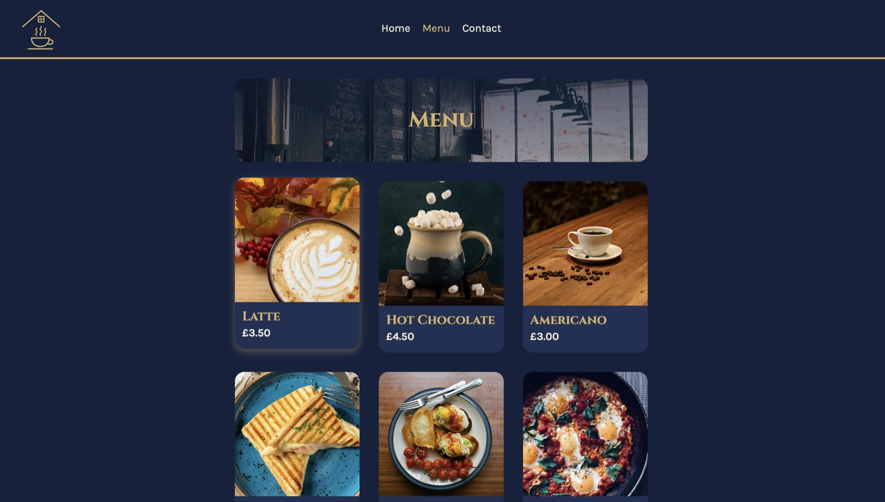
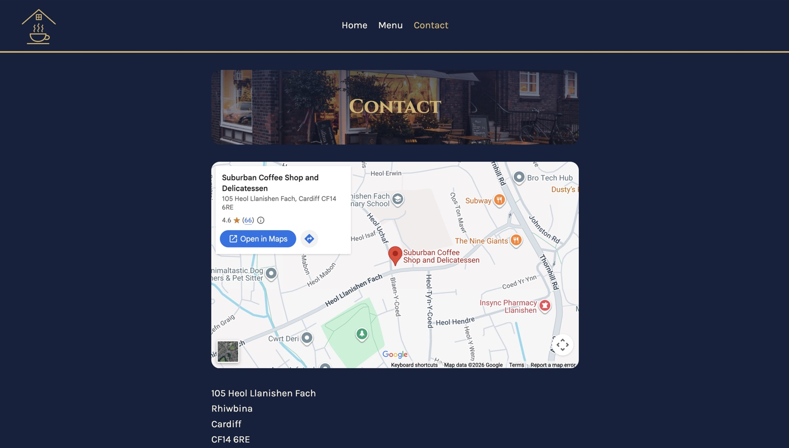

# Suburban – Restaurant Page

A single-page website for **Suburban**, a café in Rhiwbina, Cardiff. It has three tabs (Home, Menu and Contact), and every page is built with JavaScript and bundled with webpack. Built as part of The Odin Project's JavaScript course.

**[View it live](https://astongr.github.io/restaurant-page/)**





## Features

- **Tabbed navigation**: Home, Menu and Contact swap in place without reloading the page. The current tab is highlighted using `aria-current="page"`.
- **Home**: a centred hero with the café name and tagline over a tinted full-page photo.
- **Menu**: six items in a responsive card grid, each with its own photo, name and price, and a gold glow on hover.
- **Contact**: an embedded Google Map, the address, phone and Instagram links, and the opening times laid out side by side.
- **Matching page banners**: Menu and Contact share one banner style, with a different photo on each.
- **Responsive layout**: the menu grid drops to fewer columns on smaller screens, and the footer stays at the bottom on short pages.
- **Keyboard friendly**: visible focus states on the nav buttons and links.

## What I practised

- **Webpack**: setting up a project with npm, an entry point, `HtmlWebpackPlugin` for the HTML template, loaders for CSS and images, and `webpack-dev-server` for live reloading.
- **ES6 modules**: each page lives in its own module (`home.js`, `menu.js`, `contact.js`) and exports one function that `index.js` imports.
- **Building the DOM with JavaScript**: creating, configuring and appending elements, with small helper functions that build an element and return it, so the caller decides where it goes.
- **Data-driven rendering**: menu items are an array of objects, rendered with `forEach`, so adding an item is one line of data.
- **CSS**: custom properties, Grid and Flexbox layouts, layered background images with gradient tints, `:has()`, `aspect-ratio` and `object-fit`, and a stylesheet grouped into sections.
- **Git and pull requests**: built on feature branches with one pull request per feature, squash-merged into `main`, and deployed to GitHub Pages from the `dist` folder.

## Built with

- HTML
- CSS
- JavaScript (vanilla)
- webpack

## Running it locally

```bash
npm install
npx webpack serve
```

## Credits

- Suburban is inspired by a real café, used with the owner's permission. The logo is based on the café's own logo, and the latte photo was provided by the owner. Menu items, prices, opening times and the Instagram handle are made up for this demo.
- Photos from [Pexels](https://www.pexels.com):
  - Contact banner: Niklas Jeromin
  - Hot Chocolate: Skylar Ewing
  - Americano: Vinicius Vieira
  - Poached Eggs on Toast: The Narrative Lens
  - Ham and Cheese Toastie: MikeGz
  - Shakshuka: Julia Khalimova
  - Home background and Menu banner: Pexels
- Fonts: [Cinzel](https://fonts.google.com/specimen/Cinzel) and [Karla](https://fonts.google.com/specimen/Karla) from Google Fonts.
- Map: [Google Maps](https://www.google.com/maps) embed.
